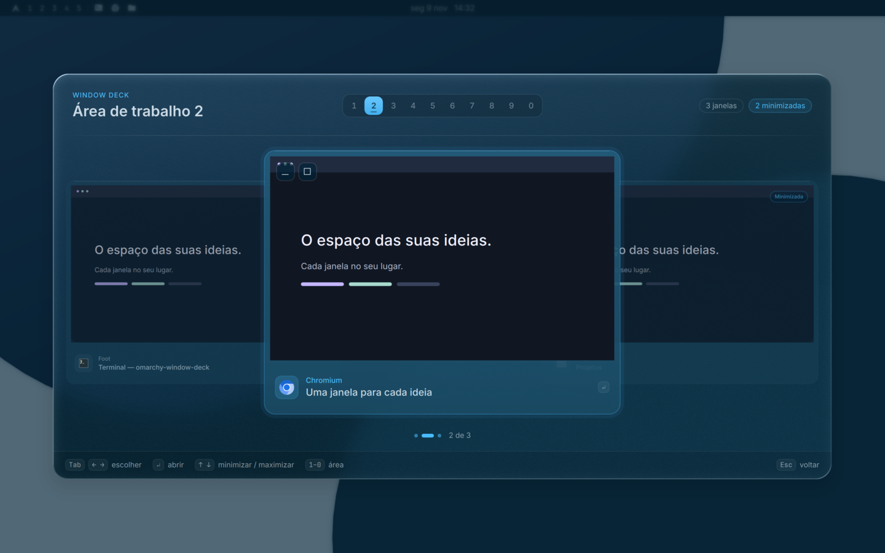
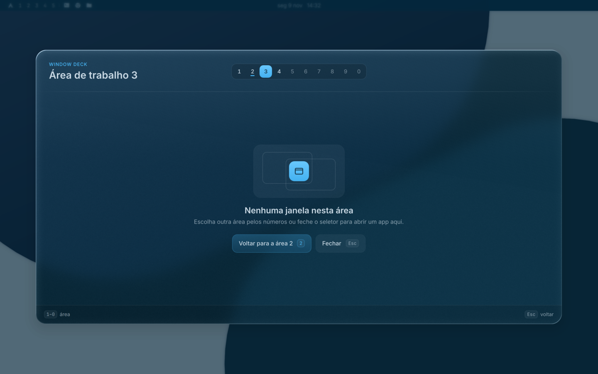

# Window Deck

Plugin do Omarchy que mostra as janelas minimizadas ao lado dos desktops e abre um seletor de janelas com miniaturas em **Super+Tab**. Cada monitor e área de trabalho mantém seu próprio conjunto de janelas. Cores, fontes e ícones da barra acompanham o Omarchy.



O seletor tem o mesmo vidro líquido do launcher: ao abrir, desfoca o desktop e pinta o painel com refração na borda, reflexo no topo e granulação. Numa área sem janelas, ele explica o que fazer e oferece voltar para a área atual:



As prévias usam os componentes reais com janelas ilustrativas. [Ver os ícones da barra](docs/bar-preview.png).

## Requisitos

- Omarchy com `omarchy-shell` Quickshell, plugins e configuração Lua do Hyprland.
- `hyprctl`, disponível na instalação do Omarchy. O runtime não usa Python.
- Testado com a API Lua do Hyprland 0.56.2. Outros shells e configurações legadas em hyprlang não são suportados.

Não há pacotes adicionais para instalar. O plugin não usa rede e não grava miniaturas em disco.

## Instalação

No terminal da sua sessão Omarchy:

```bash
omarchy plugin add https://github.com/eusener/omarchy-window-deck.git --enable
omarchy plugin enable eusener.window-deck --section left --after omarchy.workspaces
```

O gerenciador clona o repositório em `~/.config/omarchy/plugins/eusener.window-deck`. Se você usa uma cópia personalizada do widget de desktops, substitua `omarchy.workspaces` pelo id dessa cópia no segundo comando.

O repositório já contém o runtime pronto, o manifesto na raiz e as traduções. Nenhum script é executado durante a instalação. Esse é o [contrato de plugins do Omarchy](https://github.com/omacom/omarchy/blob/quattro/docs/omarchy-shell.md#installing-a-third-party-plugin).

### Atalhos

Com o plugin habilitado, os atalhos já funcionam, sem editar nenhum arquivo:

| Atalho | Ação |
|---|---|
| Super+Tab | Abrir o seletor (substitui **Next workspace** do Omarchy) |
| Ctrl+Super+↓ | Minimizar a janela ativa |
| Ctrl+Super+Alt+↑ | Restaurar a maximizada ativa ou trazer a minimizada mais recente |
| Ctrl+Super+↑ | Maximizar a janela ativa |

Ao carregar, o plugin consulta `hyprctl binds` e registra cada atalho pelo `hyprctl eval`, no Hyprland em execução. Ele só usa combinações livres ou com o padrão do Omarchy. Se você já ligou uma dessas combinações a outra ação em `bindings.lua`, ela fica como está. Um `hyprctl reload` apaga os atalhos registrados assim, e o plugin registra de novo logo em seguida. Com o plugin desabilitado ou removido, eles somem no próximo reload. Junto com os atalhos vai a regra que desfoca o que fica atrás do seletor, como nos overlays do próprio Omarchy; ela só tem efeito com o blur do Hyprland ligado, pelo modo Glassy.

Minimizar e restaurar rodam dentro do Hyprland, sem iniciar nenhum processo. Cada tecla carrega a versão atual de `operations.lua`, então uma atualização do plugin vale sem `hyprctl reload`. O menu de atalhos do Omarchy (`omarchy menu keybindings --print`) mostra e consegue executar esses atalhos. Ctrl+Super+↓ minimiza também em áreas em mosaico; Super+M fica com a minimização nativa do Omarchy. Super+Shift+Tab e Super+Ctrl+Tab mantêm suas ações fora do seletor.

Para manter **Next workspace** no Super+Tab, ligue a combinação em `~/.config/hypr/bindings.lua` com outra descrição, e o plugin não mexe nela:

```lua
o.rebind("SUPER + TAB", "Área seguinte", hl.dsp.focus({ workspace = "m+1" }))
```

Quem preferir os atalhos gravados em arquivo pode usar o bloco que o `install.py` escreve em `bindings.lua`; o plugin reconhece esses atalhos e não os registra de novo.

O seletor também pode ser aberto sem atalho:

```bash
omarchy-shell shell summon eusener.window-deck '{}'
```

## Uso

| Ação | Controle |
| --- | --- |
| Minimizar a janela ativa | Ctrl+Super+↓ |
| Restaurar o tamanho da maximizada ativa ou trazer a minimizada mais recente | Ctrl+Super+Alt+↑ |
| Maximizar a janela ativa | Ctrl+Super+↑ |
| Abrir o seletor da área atual | Super+Tab |
| Próxima janela | Tab, seta direita ou repetir Super+Tab |
| Janela anterior | Shift+Tab ou seta esquerda |
| Abrir ou restaurar a selecionada | Enter ou clique no cartão selecionado |
| Ver outra área de trabalho do monitor | Teclas 1–9 e 0 (área 10), ou clique na faixa de áreas |
| Minimizar ou tirar da maximização a selecionada | Seta para baixo, ou botão no cartão |
| Maximizar ou restaurar a selecionada minimizada | Seta para cima, ou botão no cartão |
| Selecionar uma miniatura lateral | Clique no cartão lateral |
| Cancelar | Esc ou clique fora dos cartões |
| Repetir consulta após erro | R ou botão ↻ |

Soltar Super não confirma a seleção. A barra mostra até seis ícones, um por janela minimizada da área ativa daquele monitor. Clique para restaurar. O botão +N abre as minimizadas excedentes. Sem minimizadas, a faixa não ocupa espaço.

Ctrl+Super+Alt+↑ primeiro restaura o tamanho anterior da janela ativa, se ela estiver maximizada. Caso contrário, usa o histórico de foco para trazer a janela minimizada mais recente da área ativa no tamanho dela, nunca maximizada; se outra janela da área estiver maximizada, ela é desmaximizada para a restaurada aparecer. Sem uma janela maximizada ativa nem minimizadas elegíveis, não faz nada. Janelas de outras áreas ficam onde estão. Ctrl+Super+↑ aplica a maximização nativa, preservando a barra, sem alternar para tela cheia.

O seletor abre na área atual, com as janelas abertas e minimizadas dela, e exclui scratchpads. As teclas numéricas mostram outra área do mesmo monitor, seguindo os blocos do Omarchy (1–10 no primeiro monitor, 11–20 no seguinte); ver outra área não troca a área ativa. Enter numa janela de outra área leva até ela. A faixa no cabeçalho marca a área exibida e a atual, e esmaece as vazias.

As setas para cima e para baixo sobem e descem um degrau entre minimizada, normal e maximizada, sem fechar o seletor e sem trocar o foco: para baixo minimiza uma janela normal ou tira uma maximizada da maximização; para cima restaura uma minimizada na área dela ou maximiza uma normal. Maximizar uma janela tira a maximização da que ocupava a área. Os mesmos comandos aparecem como botões no cartão selecionado. Ao sair com Esc, o foco volta à última janela gerenciada na área atual. A seleção acompanha a janela pelo endereço mesmo quando a lista muda. A interface respeita o idioma, a fonte, as cores e a preferência de animações do Omarchy. Há traduções em português brasileiro e inglês, com fallback para inglês nos demais idiomas.

## Atualizar

```bash
omarchy plugin update eusener.window-deck
```

As entradas da interface apontam para um diretório `runtime/` identificado pela versão e pelo conteúdo. Uma atualização usa caminhos novos para evitar que o Quickshell reutilize componentes antigos em cache. Não é necessário executar um build nem o instalador Python após `omarchy plugin update`.

## Desativar ou remover

```bash
omarchy plugin disable eusener.window-deck
```

Para remover:

```bash
omarchy plugin remove eusener.window-deck
```

Os atalhos registrados pelo plugin somem no próximo `hyprctl reload`, e os padrões do Omarchy voltam. Se você tinha acrescentado o bloco de atalhos em `bindings.lua`, retire-o antes e rode `hyprctl reload` e `hyprctl configerrors`. O dock do Omarchy continua podendo recuperar janelas minimizadas. A remoção não encerra aplicativos.

## Migrar uma cópia criada pelo instalador antigo

Uma cópia instalada por `install.py` não é um checkout Git e ocupa o mesmo id. Antes de usar `omarchy plugin add`, remova essa cópia com seu próprio desinstalador:

```bash
python3 "$HOME/.config/omarchy/plugins/eusener.window-deck/install.py" --uninstall
```

Essa etapa vale somente para a instalação antiga, marcada pelo arquivo `.window-deck-owned.json` e sem `.git`. Ela faz backup e remove seu bloco gerenciado de atalhos. Em seguida, siga a instalação e a configuração dos atalhos acima. Não apague a configuração inteira do Omarchy.

O `install.py` continua no repositório para compatibilidade com essas cópias e desenvolvimento local. Ele recusa substituir ou remover um checkout Git. Instalações do gerenciador são atualizadas e removidas pelos comandos `omarchy plugin`.

## Miniaturas e limites

A captura usa a [API ScreencopyView do Quickshell](https://quickshell.org/docs/v0.3.1/types/Quickshell.Wayland/ScreencopyView/) somente nos cartões próximos enquanto o seletor está aberto. Janelas minimizadas, protegidas ou sem suporte de captura podem apresentar apenas ícone, título e “Prévia indisponível”. O plugin não restaura janelas temporariamente para capturá-las.

Em janelas transparentes, como terminais no modo Glassy, a miniatura mostra atrás da janela o trecho do papel de parede que fica atrás dela no desktop. Com o blur do Hyprland ligado, esse fundo aparece desfocado; desligado, aparece nítido. O desfoque da miniatura é uma aproximação do blur do Hyprland.

A minimização segue a convenção do Omarchy: workspace `special:minimized` e tag `omarchy-minimized-from-N`. Origens inválidas ou ambíguas não são inventadas. Janelas sem origem válida ficam fora do filtro e continuam recuperáveis pelo dock. Mudanças concorrentes são validadas dentro de uma única operação Lua antes de mover ou focalizar uma janela.

## Desenvolvimento

Veja [CONTRIBUTING.md](CONTRIBUTING.md) para gerar o runtime, executar os testes e preparar uma versão. [DESIGN.md](DESIGN.md) registra as regras visuais e a integração com o tema. [CHANGELOG.md](CHANGELOG.md) descreve as versões.

Licença MIT. Copyright © 2026 Eusener Castilho.
