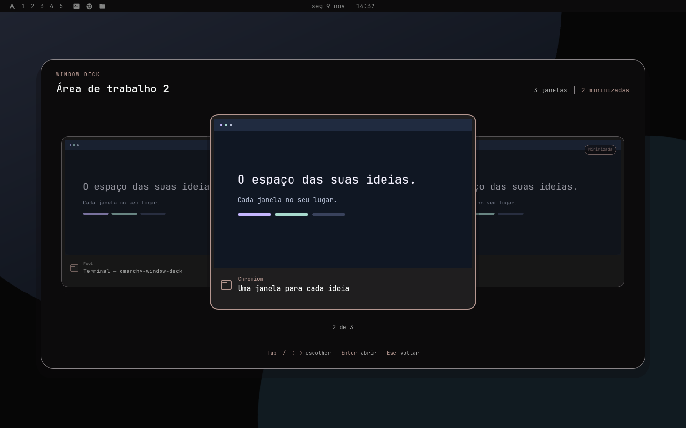

# Window Deck

Plugin do Omarchy que mostra as janelas minimizadas ao lado dos desktops e abre um seletor de janelas com miniaturas em **Super+Tab**. Cada monitor e área de trabalho mantém seu próprio conjunto de janelas. Cores, fontes e ícones da barra acompanham o Omarchy.



A prévia usa os componentes reais com janelas ilustrativas. [Ver os ícones da barra](docs/bar-preview.png).

## Requisitos

- Omarchy com `omarchy-shell` Quickshell, plugins e configuração Lua do Hyprland.
- Python 3 e `hyprctl`, disponíveis na instalação do Omarchy.
- Testado com a API Lua do Hyprland 0.56.2. Outros shells e configurações legadas em hyprlang não são suportados.

Não há pacotes adicionais para instalar. O plugin não usa rede e não grava miniaturas em disco.

## Instalação

No terminal da sua sessão Omarchy:

```bash
omarchy plugin add https://github.com/eusener/omarchy-window-deck.git --enable
omarchy plugin enable eusener.window-deck --section left --after omarchy.workspaces
```

O gerenciador clona o repositório em `~/.config/omarchy/plugins/eusener.window-deck`. Se você usa uma cópia personalizada do widget de desktops, substitua `omarchy.workspaces` pelo id dessa cópia no segundo comando.

O repositório já contém o runtime pronto, o manifesto na raiz e as traduções. Nenhum script é executado durante a instalação. Esse é o [contrato de plugins do Omarchy](https://github.com/omacom/omarchy/blob/quattro/docs/omarchy-shell.md#installing-a-third-party-plugin).

### Atalhos

Confira os atalhos atuais com `omarchy menu keybindings --print`. Acrescente estas quatro linhas a `~/.config/hypr/bindings.lua`:

```lua
o.rebind("SUPER + TAB", "Window Deck", "omarchy-shell shell summon eusener.window-deck '{}'")
o.rebind("SUPER + M", "Minimizar janela", 'python3 "$HOME/.config/omarchy/plugins/eusener.window-deck/backend.py" minimize')
o.rebind("SUPER + CTRL + M", "Restaurar janela minimizada", 'python3 "$HOME/.config/omarchy/plugins/eusener.window-deck/backend.py" restore-last')
o.rebind("SUPER + CTRL + SHIFT + M", "Maximizar janela", hl.dsp.window.fullscreen({ mode = "maximized", action = "set" }))
```

Super+Tab substitui **Next workspace**. Super+M substitui a minimização nativa para funcionar também em áreas em mosaico. Super+Shift+Tab e Super+Ctrl+Tab mantêm suas ações fora do seletor. Aplicar e conferir:

```bash
hyprctl reload
hyprctl configerrors
```

O seletor também pode ser aberto sem atalho:

```bash
omarchy-shell shell summon eusener.window-deck '{}'
```

## Uso

| Ação | Controle |
| --- | --- |
| Minimizar a janela ativa | Super+M, após configurar o atalho |
| Restaurar a minimizada mais recente da área ativa | Super+Ctrl+M, após configurar o atalho |
| Maximizar a janela ativa | Super+Ctrl+Shift+M, após configurar o atalho |
| Abrir o seletor da área atual | Super+Tab, após configurar o atalho |
| Próxima janela | Tab, seta direita ou repetir Super+Tab |
| Janela anterior | Shift+Tab ou seta esquerda |
| Abrir ou restaurar a selecionada | Enter ou clique no cartão selecionado |
| Selecionar uma miniatura lateral | Clique no cartão lateral |
| Cancelar | Esc ou clique fora dos cartões |
| Repetir consulta após erro | R ou botão ↻ |

Soltar Super não confirma a seleção. A barra mostra até seis ícones, um por janela minimizada da área ativa daquele monitor. Clique para restaurar. O botão +N abre as minimizadas excedentes. Sem minimizadas, a faixa não ocupa espaço.

Super+Ctrl+M usa o histórico de foco para escolher a janela minimizada mais recente da área ativa. Pressionar novamente restaura a próxima; sem minimizadas elegíveis, não faz nada. Janelas de outras áreas ficam onde estão. Super+Ctrl+Shift+M aplica a maximização nativa, preservando a barra, sem alternar para tela cheia.

O seletor inclui janelas abertas e minimizadas da área atual e exclui outros desktops e scratchpads. A seleção acompanha a janela pelo endereço mesmo quando a lista muda. A interface respeita o idioma, a fonte, as cores e a preferência de animações do Omarchy. Há traduções em português brasileiro e inglês, com fallback para inglês nos demais idiomas.

## Atualizar

```bash
omarchy plugin update eusener.window-deck
```

As entradas da interface apontam para um diretório `runtime/` identificado pela versão e pelo conteúdo. Uma atualização usa caminhos novos para evitar que o Quickshell reutilize componentes antigos em cache. Não é necessário executar um build nem o instalador Python após `omarchy plugin update`.

## Desativar ou remover

```bash
omarchy plugin disable eusener.window-deck
```

Para remover, retire primeiro as quatro linhas adicionadas em `bindings.lua`, rode `hyprctl reload` e `hyprctl configerrors`, depois:

```bash
omarchy plugin remove eusener.window-deck
```

Sem esses overrides, os atalhos padrão voltam. O dock do Omarchy continua podendo recuperar janelas minimizadas. A remoção não encerra aplicativos.

## Migrar uma cópia criada pelo instalador antigo

Uma cópia instalada por `install.py` não é um checkout Git e ocupa o mesmo id. Antes de usar `omarchy plugin add`, remova essa cópia com seu próprio desinstalador:

```bash
python3 "$HOME/.config/omarchy/plugins/eusener.window-deck/install.py" --uninstall
```

Essa etapa vale somente para a instalação antiga, marcada pelo arquivo `.window-deck-owned.json` e sem `.git`. Ela faz backup e remove seu bloco gerenciado de atalhos. Em seguida, siga a instalação e a configuração dos atalhos acima. Não apague a configuração inteira do Omarchy.

O `install.py` continua no repositório para compatibilidade com essas cópias e desenvolvimento local. Ele recusa substituir ou remover um checkout Git. Instalações do gerenciador são atualizadas e removidas pelos comandos `omarchy plugin`.

## Miniaturas e limites

A captura usa a [API ScreencopyView do Quickshell](https://quickshell.org/docs/v0.3.1/types/Quickshell.Wayland/ScreencopyView/) somente nos cartões próximos enquanto o seletor está aberto. Janelas minimizadas, protegidas ou sem suporte de captura podem apresentar apenas ícone, título e “Prévia indisponível”. O plugin não restaura janelas temporariamente para capturá-las.

A minimização segue a convenção do Omarchy: workspace `special:minimized` e tag `omarchy-minimized-from-N`. Origens inválidas ou ambíguas não são inventadas. Janelas sem origem válida ficam fora do filtro e continuam recuperáveis pelo dock. Mudanças concorrentes são validadas dentro de uma única operação Lua antes de mover ou focalizar uma janela.

## Desenvolvimento

Veja [CONTRIBUTING.md](CONTRIBUTING.md) para gerar o runtime, executar os testes e preparar uma versão. [DESIGN.md](DESIGN.md) registra as regras visuais e a integração com o tema. [CHANGELOG.md](CHANGELOG.md) descreve as versões.

Licença MIT. Copyright © 2026 Eusener Castilho.
